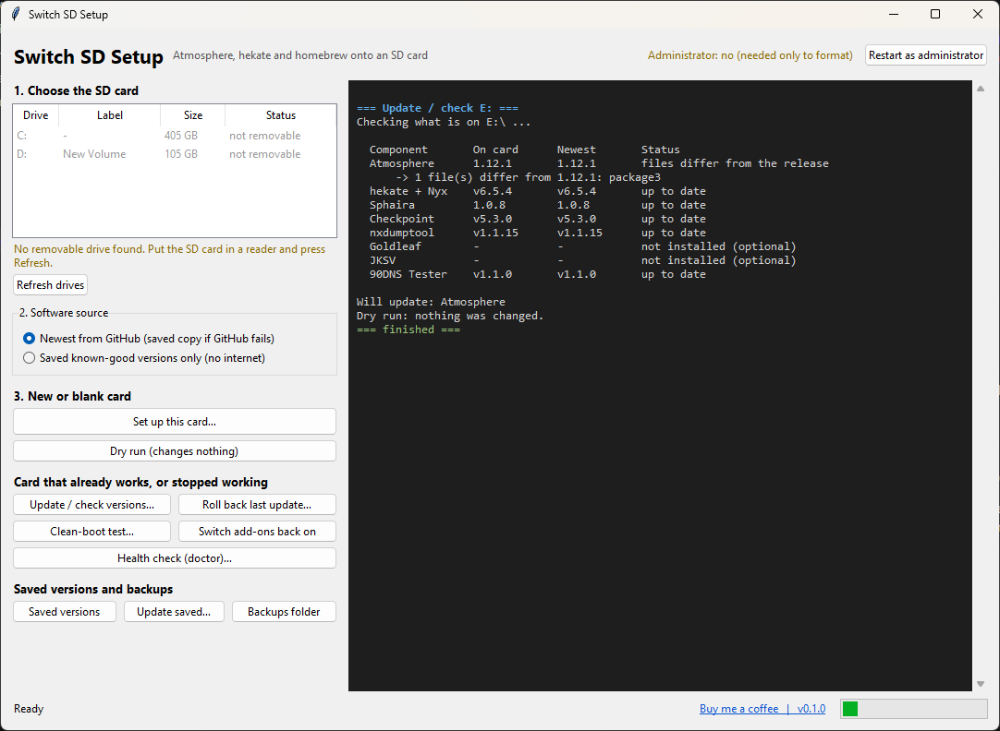

<div align="center">

# Switch SD Setup

**Build, update and repair an Atmosphere + hekate SD card for the Nintendo Switch, safely, from one Windows app.**

<a href="https://buymeacoffee.com/ok_27"></a>

[](https://github.com/Omkar-Desai01/switch-sd-setup/actions/workflows/ci.yml)
[](https://github.com/Omkar-Desai01/switch-sd-setup/releases/latest)
[](LICENSE)


[**Download**](https://github.com/Omkar-Desai01/switch-sd-setup/releases/latest) ·
[Usage guide](docs/USAGE.md) ·
[How it works](docs/HOW_IT_WORKS.md) ·
[Changelog](CHANGELOG.md)



</div>

> **Beta.** Tested with simulated drives and on copies of a real card. Please read [Safety](#safety-by-design) and
> keep a backup of anything you care about. Reports from real cards are very welcome.

## What it does

Setting up a Switch SD card by hand means downloading five or six projects, copying them to the right places,
and hoping nothing is stale. When a system update breaks the setup, finding out why is guesswork. Switch SD Setup
does the boring and risky parts for you.

| You want to | What the app does |
|---|---|
| **Set up a new card** | Backs it up, optionally formats it, installs Atmosphere, hekate, Sphaira and tools from their official releases, verifies the result, and gives you a checklist for the console-side steps |
| **Update a card that works** | Finds out which version of each component is on the card (even if you built it by hand), snapshots what it will overwrite, updates only what is behind, and can roll the whole update back |
| **Fix a card that stopped working** | Reads Atmosphere crash reports, checks the firmware against your Atmosphere version, checks the emuMMC sector and your NAND backup, and can switch third-party add-ons off and on for a clean-boot test |
| **Stay safe when GitHub is down** | Falls back to saved known-good copies of every component, hash-checked before use |

## Quick start

1. Download `SwitchSDSetup-<version>-windows.zip` from the [latest release](https://github.com/Omkar-Desai01/switch-sd-setup/releases/latest)
   and unzip it anywhere (not onto the SD card).
2. Put the SD card in a card reader and open **`SwitchSDSetup.exe`**.
3. Pick the card, press **Dry run** to see every step without changing anything, then **Set up this card**.
4. Follow the checklist for the console-side steps. The app saves it as `SETUP-CHECKLIST.txt` in a
   `SwitchSD-backups` folder inside your user folder.

Windows SmartScreen or Defender may warn about an unknown publisher because the executables are not code-signed
yet. Check the SHA-256 in `SHA256SUMS.txt` or build it yourself (below).

Prefer a terminal? `sdsetup.exe` has every feature: `sdsetup.exe update E: --dry-run`, `sdsetup.exe doctor E:`,
`sdsetup.exe --help`. See the [usage guide](docs/USAGE.md).

## Safety by design

- **Only removable drives.** The Windows system drive, fixed disks and the drive the program runs from are refused for
  formatting and installing.
- **A format needs proof.** A full backup of that exact card (matched by volume serial) from the last 24 hours, the
  typed phrase `ERASE E:`, an elevated terminal, and an unchanged drive right before it runs.
- **Updates are reversible.** Everything an update overwrites, plus your settings, is saved first. Rollback restores it
  and never touches a file you changed afterwards.
- **Clean-boot never deletes.** Add-on folders are renamed, and the moves are recorded on the card.
- **Official sources, verified.** Downloads come from each project's GitHub releases and are checked against the
  published SHA-256. Saved copies are hash-checked on every use.
- **No surprises.** No telemetry. The only network calls are to GitHub to look up and download releases.

## What it will not do

This project helps you set up **your own** console. It deliberately does not include, and will not accept
contributions for: signature or ticket-check patches, downloading games, distributing keys or firmware, or anything
else meant to run software you do not own. Its health check can *explain* why a console rejects a modified ticket
(error `0x291`); it never works around that.

## Supported components

Atmosphere, hekate (with Nyx), Sphaira, Checkpoint, nxdumptool and the 90DNS Tester are installed by default.
Goldleaf and JKSV are optional. The list lives in [`manifest.json`](manifest.json), so adding homebrew needs no code
change. Lockpick_RCM is not downloaded (its repository is blocked on GitHub); dump your own keys with it separately.

## FAQ

**Does it touch my console?** No. It only works on the SD card. RCM injection, NAND backup and emuMMC creation are
steps you do on the console; the app tells you exactly which.

**Can it tell my console's firmware?** No. Type it into the health check (`--firmware 23.0.0`); it is compared with the
newest firmware your installed Atmosphere release lists in [`compat.json`](compat.json).

**I get "GitHub API rate limit".** Unauthenticated GitHub allows 60 requests per hour. The app falls back to saved
versions or direct downloads; set the `GITHUB_TOKEN` environment variable to lift the limit.

**What are "saved versions"?** A local `vault` folder of known-good releases, created on your machine with
`sdsetup vault update`. Releases of this project do not ship third-party binaries.

**exFAT or FAT32?** Windows will not format FAT32 above 32 GB. exFAT works with Atmosphere and hekate on larger cards.

**Mac or Linux?** Not at the moment; the drive handling is Windows specific.

## Build from source

Python 3.10 or newer, no runtime dependencies.

```bash
git clone https://github.com/Omkar-Desai01/switch-sd-setup.git
cd switch-sd-setup
python -m unittest discover -s tests      # run the tests
python -m sdsetup gui                     # run the desktop app
python -m pip install pyinstaller
python build.py                           # builds release/SwitchSDSetup/
```

See [CONTRIBUTING.md](CONTRIBUTING.md) for the development workflow.

## Support the project

Switch SD Setup is free and open source. If it saved you an evening, you can
[buy me a coffee](https://buymeacoffee.com/ok_27) (the button is at the top of this page).

Bug reports from real hardware, pull requests and a star on the repository help just as much.

## Credits and disclaimer

This tool installs the work of others: [Atmosphère](https://github.com/Atmosphere-NX/Atmosphere),
[hekate](https://github.com/CTCaer/hekate), [Sphaira](https://github.com/ITotalJustice/sphaira),
[Checkpoint](https://github.com/FlagBrew/Checkpoint), [nxdumptool](https://github.com/DarkMatterCore/nxdumptool),
[Goldleaf](https://github.com/XorTroll/Goldleaf), [JKSV](https://github.com/J-D-K/JKSV) and the
[90DNS tester](https://github.com/meganukebmp/Switch_90DNS_tester). Thank you to their authors; each keeps its own
license, and none of their files are stored in this repository.

Switch SD Setup is an independent project and is not affiliated with, endorsed by or sponsored by Nintendo.
"Nintendo Switch" is a trademark of Nintendo. Use custom firmware only on a console you own, and only with software
you are entitled to use. Modifying a console can void its warranty and can get it banned from online services; you are
responsible for what you do with it. The software is provided as is, without warranty (see [LICENSE](LICENSE)).

Licensed under the [MIT License](LICENSE).
